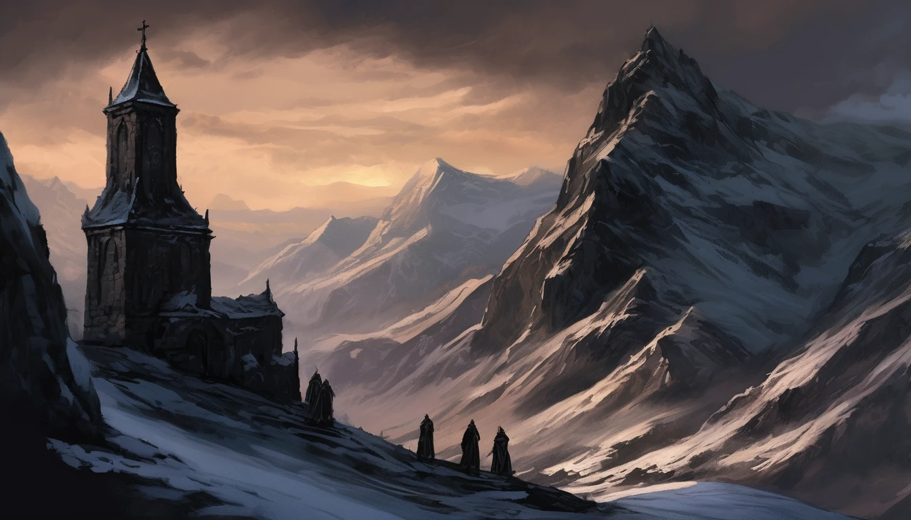
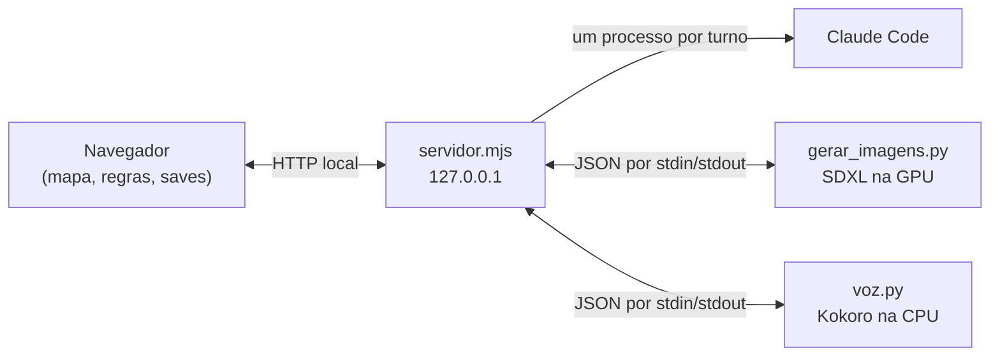

<p align="center"></p>

<h1 align="center">Os Sete Sinos</h1>

<p align="center">
RPG solo de fantasia sombria, inspirado em D&amp;D 5e, jogado no navegador e em português do Brasil.<br>
Uma campanha original, com mapa-múndi explorável e um mestre de IA opcional que narra, pinta e fala, tudo rodando no seu computador.
</p>

---

Há trezentos anos, sete sinos fundidos da coroa do Rei Cinzento o mantêm adormecido sob o Monte Cinzário. Nove noites atrás, o Primeiro Sino calou, e o povo de Vau-Claro passou a acordar com gosto de cinza na boca. Você chega à cidade com uma carta do burgomestre e pouco ouro na bolsa.

**Estado atual:** a Missão 1, *O Sino Mudo*, pode ser jogada do prólogo ao final. Os lugares das próximas missões já aparecem no mapa, mas ficam bloqueados.

## Como jogar

Você só precisa do [Node.js](https://nodejs.org) (testado na v24). O projeto não tem dependências npm nem etapa de build.

No Windows, dê dois cliques em `iniciar.bat`. Ele encerra um servidor antigo do jogo, sobe o novo e abre `http://127.0.0.1:8787`.

Em outro ambiente, ou sem o `.bat`:

```bash
node servidor/servidor.mjs
```

Os recursos de IA são opcionais e ligados um a um. O jogo detecta o que está disponível:

| Modo | O que precisa | O que você ganha |
|---|---|---|
| Página aberta direto (`index.html`) | Só o navegador | Campanha escrita, combate e mapa; save apenas no navegador |
| Servidor local | Node.js | Tudo acima, mais saves em arquivo |
| Mestre ao vivo | [Claude Code](https://claude.com/claude-code) instalado e logado | Campo de texto para conversar com o mestre, que reage e altera o jogo |
| Imagens ao vivo | Ambiente Python e GPU | O mestre pinta momentos marcantes durante a partida |
| Voz | Ambiente Python | Narração falada em português |

## O que há no jogo

### Campanha

- Prólogo narrado em 5 cenas e criação de personagem com 4 classes
- 62 cenas escritas, distribuídas por 26 locais em níveis: mundo, lugar, sala e detalhe
- Marcadores clicáveis sobre mapas pintados da cidade, da floresta, da toca, da abadia e da cripta
- Descrição longa na primeira visita a cada local
- Decisões com consequência no final da missão
- Crônicas de Valdren, com 7 capítulos ilustrados sobre história, deuses e facções
- Ficha do herói, mochila e diário preenchido automaticamente

### Regras

As regras são uma versão simplificada de D&D 5e:

- Testes de d20 mais atributo, com bônus de +2 em perícias da classe, contra uma CD
- Combate por turnos contra 6 encontros, com crítico no 20 e erro automático no 1
- Habilidades com usos limitados, poções e descanso na taverna
- Derrota sem fim de jogo: você acorda no templo dois dias depois, com menos ouro

| Classe | Vida | CA | Arma | Habilidade |
|---|---|---|---|---|
| Guerreiro | 13 | 16 | Espada longa (d8) | Retomar Fôlego: cura, 1 uso |
| Ladina | 10 | 14 | Adagas (d6) | Ataque Furtivo: +2d6, 2 usos |
| Clérigo de Vael | 11 | 16 | Maça de bronze (d6), +d4 contra mortos-vivos | Curar Ferimentos: cura, 3 usos |
| Maga | 8 | 12 | Raio de Fogo (d10) | Mísseis Mágicos: acerto automático, 3 usos |

### Mapa de Valdren

O continente tem 240×160 tiles de 9 km, e cada hexágono equivale a um dia de marcha (36 km). O mundo é gerado a partir de uma semente fixa e de uma geografia definida à mão, então é sempre o mesmo. Esse terreno define biomas e rotas, e a pintura do mapa aparece por cima dele.

- 11 lugares (4 jogáveis e 7 bloqueados) e 4 reinos com fronteiras
- Viagem por A*, com ritmo lento, normal ou rápido (27, 36 ou 45 km/dia)
- Fora de estrada, terreno difícil custa o dobro e montanha o triplo; o mar faz 72 km/dia de porto a porto
- Calendário, tabelas de encontro por bioma e dados de d4 a d100
- Régua, marcadores próprios, névoa de guerra pintável e camadas opcionais
- Dois modos: **Jogadores**, com névoa e lugares ocultos, e **Mestre**, para editar lugares, segredos e reinos

| Tecla | Ação | Tecla | Ação |
|---|---|---|---|
| `1` a `5` | Trocar de ferramenta | `H` | Mostrar hexágonos |
| `M` | Alternar Mestre e Jogadores | `P` | Pausar |
| `F` | Ver o mapa inteiro | `+` e `-` | Zoom |
| `G` | Ir até o grupo | `Esc` | Fechar e limpar |

A interface também funciona em telas pequenas e por toque, e respeita a preferência de movimento reduzido do sistema.

### Mestre ao vivo

Com o Claude Code disponível, um campo de texto aparece ao lado da narração, e você pode tentar o que os botões não oferecem. A resposta chega em tempo real e a conversa continua na mesma sessão, inclusive depois de recarregar a partida.

Além de narrar, o mestre pode pedir testes, iniciar combates, dar ou tirar vida, ouro e XP, marcar pistas, mover o herói e trocar a imagem da cena. Tudo isso passa por uma lista fechada de ações, com limites, em `aplicarAcoes` ([js/jogo.js](js/jogo.js)). A conclusão da missão continua nas mãos do jogo.

O mestre roda em uma pasta temporária vazia, sem ferramentas nem acesso ao projeto. Usa o login que já existe na máquina, sem chave de API.

### Imagens ao vivo

Em momentos marcantes, o mestre pode encomendar uma ilustração ao Stable Diffusion XL local. A pintura leva cerca de 30 segundos, conforme a GPU, e surge sozinha sem pausar o jogo. Há um intervalo mínimo de 4 turnos entre pinturas novas, e as prontas ficam em `img/vivo/` para reaparecer quando a história pedir.

### Voz do mestre

O texto é dividido em frases e sintetizado pelo Kokoro-82M, na CPU, para não disputar memória com o pintor. O áudio recebe um tratamento de voz grave com reverberação de salão de pedra, e cada frase gerada fica em cache. Há botões para ligar, calar e ajustar o volume.

### Saves

- **Automático:** grava a campanha cerca de 2 segundos depois de cada mudança, em `saves/`
- **Pontos com nome:** instantâneos para voltar quando quiser
- **Tela inicial:** continuar, carregar, excluir ou começar outra campanha sem apagar as demais
- **Código da campanha:** texto para levar a partida a outro computador
- **Sem servidor:** a partida fica só no navegador; use o código da campanha para levá-la ao jogo aberto pelo servidor

Ao carregar um ponto salvo, o mestre é avisado para desconsiderar o que narrou depois dele.

## Instalar a IA local

> O repositório não fixa versões nem tem `requirements.txt`. Os pacotes abaixo foram deduzidos dos imports e estas etapas ainda não foram testadas em uma máquina limpa.

Tudo fica em `.ia/`, fora do Git. Os caminhos usados pelo servidor são os do Windows (`Scripts\python.exe`).

### Mestre

Instale o Claude Code e faça login. O servidor procura o executável nesta ordem: variável `CLAUDE_BIN`, extensão do VS Code e `PATH`.

### Imagens

Instale antes o PyTorch com suporte à sua GPU, seguindo [pytorch.org](https://pytorch.org/get-started/locally/).

```powershell
python -m venv .ia\venv
.ia\venv\Scripts\pip install torch diffusers transformers accelerate safetensors pillow
```

Os modelos são baixados em `.ia\hf` na primeira execução. Na próxima abertura do jogo, a mensagem `Pintor pronto` aparece no terminal.

### Voz

```powershell
python -m venv .ia\venv-voz
.ia\venv-voz\Scripts\pip install kokoro numpy
```

A voz roda offline por padrão, então o primeiro uso precisa liberar o download do modelo. Inicie o jogo uma vez assim e deixe o mestre falar uma frase:

```powershell
$env:HF_HUB_OFFLINE = "0"
.\iniciar.bat
```

Se a voz falhar em português, instale também o [espeak-ng](https://github.com/espeak-ng/espeak-ng/releases).

### Gerar as ilustrações

As 37 imagens em `img/` já vêm no repositório. Para recriá-las ou criar novas, use o ambiente das imagens:

```powershell
.ia\venv\Scripts\python.exe -I ferramentas\gerar_imagens.py              # gera as que faltam
.ia\venv\Scripts\python.exe -I ferramentas\gerar_imagens.py taverna --refazer
.ia\venv\Scripts\python.exe -I ferramentas\gerar_imagens.py --mapas      # repinta os mapas
```

A lista de cenas e o estilo ficam em [img/LEIA-ME.md](img/LEIA-ME.md). Qualquer arquivo `img/<cena>.webp`, `.png` ou `.jpg` substitui a arte desenhada em código. O modo `--mapas` depende de bases em `.ia/bases`, que não estão no repositório, e grava o resultado em `.ia/repintura` para revisão.

## Configuração

| Variável | Padrão | Uso |
|---|---|---|
| `PORTA` | `8787` | Porta do servidor (o `iniciar.bat` usa a padrão) |
| `CLAUDE_BIN` | detecção automática | Caminho do executável do Claude Code |
| `VOZ` | `pm_santa` | Voz do Kokoro |
| `PASTA_SAVES` | `saves/` | Pasta dos saves |

Tom, velocidade, reverberação e pronúncia de nomes ficam no início de [ferramentas/voz.py](ferramentas/voz.py). Depois de mudar, reabra o jogo.

## Como funciona



As regras e o estado da partida ficam no navegador, em JavaScript puro, sem framework. O servidor Node, sem dependências, entrega os arquivos, grava os saves e controla os processos de IA.

A cada turno, a página envia o estado real do jogo junto da fala do jogador. O mestre responde em texto e pode terminar com uma linha `<acoes>{...}</acoes>`, que a página valida antes de aplicar.

```text
├── index.html              Página única do jogo
├── iniciar.bat             Inicialização no Windows
├── css/                    Estilos e fontes locais
├── img/                    Ilustrações, mapas e pinturas ao vivo (vivo/)
├── js/
│   ├── mapa.js             Geração do mundo, câmera, viagem e ferramentas
│   ├── arte.js             Cenas desenhadas em código e carga das imagens
│   ├── campanha.js         Lore, lugares, cenas e combates
│   ├── voz.js              Fila de frases e reprodução
│   └── jogo.js             Imersão, regras, saves, tela inicial e mestre ao vivo
├── servidor/
│   ├── servidor.mjs        Servidor local e API
│   └── mestre.md           Instruções do mestre (contém os segredos da história)
├── ferramentas/
│   ├── gerar_imagens.py    Geração de imagens e modo pintor
│   ├── voz.py              Síntese de voz
│   └── parar_servidor.ps1  Libera a porta antes de iniciar
├── saves/                  Campanhas salvas (fora do Git)
└── .ia/                    Ambientes, modelos e cache (fora do Git)
```

### API local

| Método e rota | Função |
|---|---|
| `GET /api/status` | Informa quais serviços estão disponíveis |
| `POST /api/mestre` | Turno do mestre, com resposta em NDJSON |
| `POST /api/imagem` | Pede uma pintura |
| `POST /api/voz` | Devolve o áudio WAV de uma frase |
| `GET`, `POST /api/saves` | Lista ou grava saves |
| `GET`, `DELETE /api/saves/:id` | Abre ou exclui um save |

O servidor escuta apenas em `127.0.0.1`, recusa pedidos com `Host` ou `Origin` de fora e só entrega `index.html`, `css/`, `js/` e `img/`.

## Criar conteúdo

Novas missões entram como dados em [js/campanha.js](js/campanha.js):

| Para adicionar | Edite |
|---|---|
| Lugar no mapa do mundo | `LUGARES_MAPA` |
| Local navegável | `NOS` (e `CHEGADAS` para a primeira descrição) |
| Cena, opção ou teste | `CENAS` |
| Combate | `LUTAS` |
| Lore | `LORE` |

Se o mestre ao vivo precisar usar o conteúdo novo, atualize também [servidor/mestre.md](servidor/mestre.md) e, para marcos e combates, `FLAGS_MESTRE` e `LUTA_FEITA` em [js/jogo.js](js/jogo.js).

## Problemas comuns

| Sintoma | O que fazer |
|---|---|
| O campo do mestre não aparece | O servidor não encontrou o Claude Code: defina `CLAUDE_BIN` com o caminho do executável e reabra o jogo |
| O campo do mestre aparece, mas ele não responde | Confira se o Claude Code está logado: o indicador "ao vivo" mostra que o executável foi encontrado, não que há login |
| "A porta 8787 já está em uso" | Feche a outra janela do jogo ou use outra `PORTA` |
| Sem imagens ou sem voz | Confira se `.ia\venv` e `.ia\venv-voz` existem e reabra o jogo |
| Imagem nova não aparece | O herói mudou de lugar ou entrou em combate durante a pintura: ela fica guardada para uso posterior |

## Créditos

As fontes Cinzel (Natanael Gama) e Alegreya (Juan Pablo del Peral) são distribuídas sob a [SIL Open Font License 1.1](https://openfontlicense.org). Mais detalhes em [css/fontes/LICENCA.txt](css/fontes/LICENCA.txt).

O mundo, os personagens e a história são originais. As regras se inspiram em D&D 5e, sem vínculo oficial com a Wizards of the Coast.
